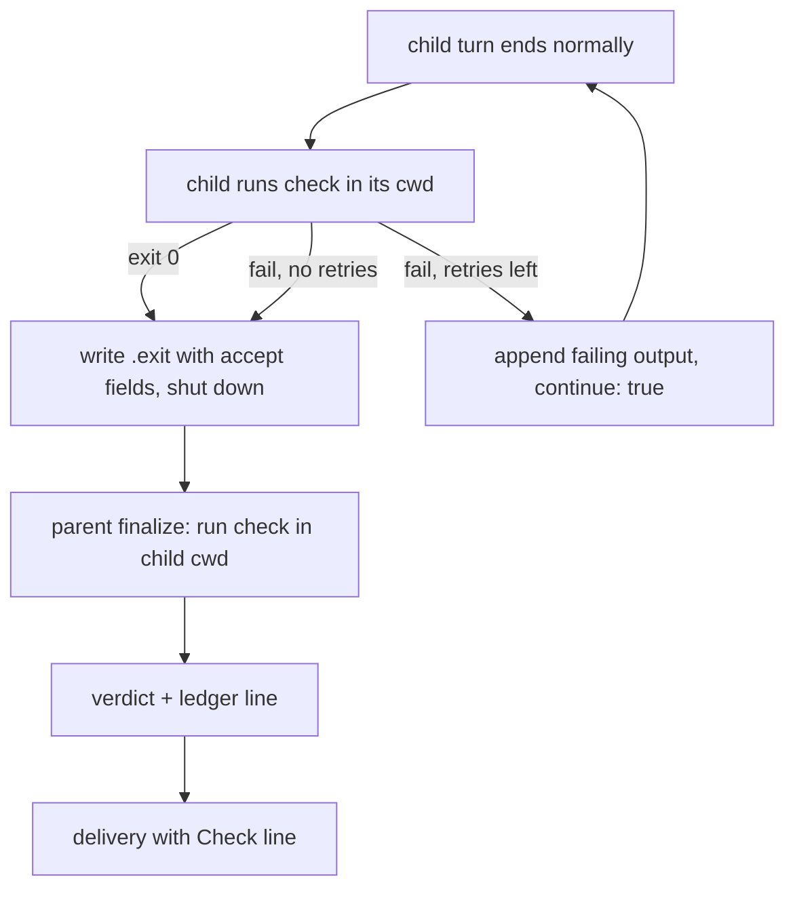

# Accept check design

- **Status:** Implemented as `delegation-outcome/v0.1`
  ([ADR-0017](adr/0017-accept-check.md)). The shipped behavior is in
  [`tools.md`](tools.md#accept-checks),
  [`configuration.md`](configuration.md#outcome-ledger), and the
  [contract](delegation-outcome-contract.md#verdicts), which govern where this
  note differs. See [As implemented](#as-implemented) for the differences; the
  [open questions](#open-questions) and [later steps](#rollout) remain.
- **Code anchors:** every `file:line` cites commit
  `97944a65f840a6a1026b1947a8dc7ae3a9e8e61e`, before the code was split; they
  are historical. The implementation lives in `maestro/core/accept.ts`,
  `maestro/adapters/pi/accept-runner.ts`,
  `maestro/adapters/pi/child/accept-check.ts`,
  `maestro/runtime/accept-recheck.ts`, and `finalize` in
  `maestro/runtime/pi-run-session.ts`.
- **Constrained by:** [ADR-0013](adr/0013-pack-neutral-execution-host.md)
  (pack-neutral host) and
  [ADR-0014](adr/0014-operator-cancel-terminal-intent.md) (operator cancel).
- **Domain language:** [`../CONTEXT.md`](../CONTEXT.md)

## Problem

A delegated child "completes" when its Pi session stops. The host then delivers
the child's last assistant message to the parent. Nothing checks the work.

The glossary already says so. A child result delivery "does not establish that
the work is correct or accepted" (`CONTEXT.md:53-56`). Today the auto-exit
child writes `{ "type": "done" }` as soon as the latest turn ends normally
(`maestro/adapters/pi/child/subagent-done.ts:296-313`). The parent turns exit
code 0 into `completed` (`maestro/runtime/run-session.ts:728-746`) and presents
it as `Sub-agent "x" completed` (`pi-extension/subagents/index.ts:871-873`).

Methodology packs work around this in prompt text. They tell the parent to run
the tests after every handoff. A parent that forgets, or a child that reports
"all tests pass" without running them, slips through. The parent has to re-read
the child's claim and decide what to trust.

## Goals and non-goals

Goals:

- A caller can attach a shell command to a `subagent` call. The host runs it and
  reports a verdict from a closed set beside the result.
- A failing check sends the child back to work in the same session, a bounded
  number of times, before the run ends.
- The parent's own run of the check decides the verdict. The child's report is
  evidence only.
- Each run attempt appends one line to a local outcome ledger that later routing
  tools can read.
- The design touches no terminal or pane state. It works on Herdr 1 today and on
  herdr-core (hc) later.

Non-goals:

- The host ships no checks, no default command, and no review or planning
  workflow. The caller supplies the check and the host enforces it (ADR-0013).
- No automatic model fallback on a rejected verdict. A rejected run is a
  completed negative result, which today's fallback rules already exclude
  (`maestro/core/config/task-model-init.ts:107`).
- No routing changes in the first version. The ledger is written, not read.
- No sandbox. The check has the same power as any child `bash` call.

## Proposed contract

### Parameter

`subagent` gains one optional object. The sketch below follows the existing
TypeBox schema (`pi-extension/subagents/index.ts:218-301`).

```ts
accept: Type.Optional(
	Type.Object({
		run: Type.String({ minLength: 1 }), // shell command, run with `sh -c`
		maxRetries: Type.Optional(Type.Integer({ minimum: 0, maximum: 5 })), // default 1
		timeoutSec: Type.Optional(Type.Integer({ minimum: 1, maximum: 3600 })), // default 600
		paths: Type.Optional(Type.Array(Type.String({ minLength: 1 }))), // check files, repo-relative
	}),
),
```

`maxRetries` counts extra child turns after a failed check. With the default of
1, the child runs the check at most twice. The parent then runs it once more.

The host validates `accept` before Herdr creates anything. In the first version
it rejects `accept` together with `persistent: true` or a non-auto-exit child.
Fork and worktree launches are allowed.

### Verdict states

The verdict is a closed set. The parent's re-check alone sets `accepted`,
`rejected`, and `error`.

| Verdict | Meaning |
| --- | --- |
| `accepted` | The run completed naturally and the parent's re-check exited 0 within the timeout. |
| `rejected` | The run completed naturally and the parent's re-check exited non-zero. |
| `error` | The parent's re-check gave no pass or fail. It timed out, the process was killed by a signal, the cwd was missing, or the spawn failed. |
| `skipped` | A check was requested, but the run did not complete naturally. The run was cancelled, it asked for help, it hit a provider error, or it exited non-zero. |
| `none` | The call requested no check. |

A cancelled run is always `skipped`, never `accepted`. A timeout is `error`,
not `rejected`, because the command never answered.

### Delivery text

`resolveResultPresentation` (`pi-extension/subagents/presentation.ts`) builds
one `ParentMessage` with three parts. The `head` holds the host's status line.
The `report` is the child's text, which `renderParentMessage` wraps in a
`subagent_report` envelope and cuts only inside it to fit 16,000 characters.
The `evidence` holds host lines such as `Model used:` and the worktree handoff.
See [the delegation outcome contract](delegation-outcome-contract.md#size-bounds).

The check lines are host-authored `HostField`s, so they never go inside the
envelope. The verdict line goes in the `head`, directly under the status line;
head fields are never dropped. The check output goes first in the `evidence`,
with its own field bound:

```text
Sub-agent "fix-parser" completed (4m 12s).
Check: rejected after 2 tries (exit 1)

<subagent_report from="fix-parser" kind="result">
...
</subagent_report>

Check output (last 1,500 characters):
FAIL test/parser.test.ts > rejects a bad date

Requested model: ...
```

Other forms are `Check: accepted (2 tries)`, `Check: error (timed out after
600s)`, `Check: skipped (cancelled)`, and `Check: none`. The host prints check
output only for `rejected` and `error`. When the child reported a pass and the
parent's re-check failed, the line says so: `Check: rejected (child reported a
pass; parent re-check exit 1)`.

The 1,500-character budget leaves room in the 3,000-character `tail` for the
model and worktree lines.

`SubagentResultDetails` (`index.ts:726-743`) gains an `accept` field with the
verdict, tries, exit code, timeout, the command hash, and any changed check
files. Structured readers then need no text parsing.

### Sidecar fields

The child's `.exit` sidecar comes from `buildCompletionSidecar`
(`subagent-done.ts:84-91`). It gains an optional `accept` object:

```json
{ "type": "done", "accept": { "tries": 2, "childVerdict": "failed", "lastExitCode": 1, "timedOut": false } }
```

`interpretExitSidecar` (`maestro/adapters/pi/completion.ts:33-60`) copies it
into `CompletionResult` (`completion.ts:8-13`). The adapter already spreads the
result into `CompletionEvidence` (`maestro/adapters/pi/pi-harness-adapter.ts:563-566`),
so the field needs a type on `CompletionEvidence`
(`maestro/core/types.ts:213-225`) and nothing else. The sidecar holds no check
output. The full output stays in the child's session as the retry message.

### Outcome ledger

The parent appends one JSON line per run attempt to
`$PI_CODING_AGENT_DIR/herdr-agents/outcomes.jsonl`. The directory comes from
`getSubagentsConfigDir` (`pi-extension/subagents/config-path.ts:12-14`). A
fallback model launch is a separate attempt and gets its own line.

```json
{"v":1,"at":"2026-10-29T19:52:03Z","runId":"a1b2c3d4","attempt":1,"agent":"worker","requestedModel":"task:implementation","category":"implementation","model":"provider/model-id","thinking":"medium","elapsedSec":252,"outcome":"completed","checkTries":2,"verdict":"rejected","checkHash":"sha256:9f2c..."}
```

The line never holds the task text, the check output, environment values, or
the command itself. `checkHash` is a SHA-256 of the `run` string, so the same
check groups together without being readable. `category` is set only when the
call used `task:<category>` (`maestro/core/routing.ts:325-331`).

This is not the existing delivery ledger. That ledger records persistent
specialist dispatch per session generation (`CONTEXT.md:159-161`,
`maestro/runtime/pi-run-session.ts:250-260`). The new file needs its own
glossary entry and a different name everywhere.

## Flow



### Child loop

An `agent_settled` handler that calls `pi.sendUserMessage` looks like the
obvious place for the loop. Pi documents `agent_settled` as notification-only, and
`agent_before_settle` as the hook that may "append entries or request one final
continuation" (Pi 1.4.0 `docs/extensions.md`, "Choose an event by intent"). The
current `agent_settled` handler is also synchronous
(`subagent-done.ts:261-317`). The loop therefore belongs in a new
`agent_before_settle` handler:

1. If the child is not auto-exit, is persistent, has no check, or
   `event.outcome` is not `completed`, return nothing.
2. Run `sh -c <run>` in the child's cwd with the timeout. Keep the last 64 KiB
   of combined output.
3. On exit 0, record `childVerdict: "passed"` and return nothing.
4. On failure with retries left, return a `custom_message` entry holding the
   last 4,000 characters of output and `continue: true`.
5. On failure with no retries left, record `childVerdict: "failed"` and return
   nothing.

Pi awaits boundary handlers and continues when the final context does not end
in an assistant message. A pending custom message satisfies that
(`@earendil-works/pi-coding-agent` 1.1.0 `dist/core/agent-session.js:616-634`
and `1452-1474`, the version in this repository's `node_modules`). Pi then
settles normally, and the existing `agent_settled` handler writes the sidecar
with the recorded fields (`subagent-done.ts:299-313`).

The child reads the spec from a JSON file in the run's artifact directory. The
launch passes its path as `PI_SUBAGENT_ACCEPT_FILE`, next to
`PI_SUBAGENT_AUTO_EXIT` (`maestro/adapters/pi/launch.ts:891`). The system
prompt file already uses this pattern (`launch.ts:822-831`). A file avoids shell
quoting a multi-field spec inside the launch script (`launch.ts:874-916`).

### Parent re-check

The parent runs the check once more after the child exits, because the child's
verdict is self-reported. The insertion point is `finalize` in
`maestro/runtime/pi-run-session.ts:847-992`. The kernel calls it for every
attempt before delivery (`maestro/runtime/run-session.ts:486-491`).

Insert the re-check after the worktree handoff capture
(`pi-run-session.ts:915-941`) and before the lifecycle mark
(`pi-run-session.ts:942-945`). Run it only when all of these hold:

- the run carries an `accept` spec;
- `result.cancellation` is absent and `result.outcome` is `completed`;
- `exitCode` is 0 and `evidence.ping` is absent.

Store the verdict on `entry.completed` (`pi-run-session.ts:951-977`) and on
`PiCompletedMetadata` (`pi-run-session.ts:219-238`), and append the ledger line
there. Every attempt passes through `finalize`, so failed fallback attempts get
ledger lines too, with verdict `skipped`.

The re-check needs the child's cwd. A worktree child has `worktree.path`, but
`PiRunningChild` (`launch.ts:101-135`) stores no cwd for an ordinary child. The
launch must copy `targetCwd` (`launch.ts:584-592` and `launch.ts:660-668`)
onto the record in `createRunningChild` (`launch.ts:947-967`).

Run the check with an asynchronous spawn, never `execSync`. Several children
can finalize at once in one parent process.

## Decisions

| Decision | Options | Recommended default | Why |
| --- | --- | --- | --- |
| 1. Test tampering | (a) Run the parent's copy of the check files. (b) Record and show check files the child changed. (c) Both. | (b) for the first version. Show changed files on the `Check:` line, keep the verdict. | (a) means writing base copies into the child's checkout, which breaks the reviewable worktree state. (b) is free for worktrees because the handoff already lists every changed and untracked file since `baseSha` (`maestro/runtime/worktree-operations.ts:155-165`). The caller decides what a changed test means. |
| 2. Timeout and output cap | Fixed or per-call timeout. Keep full or capped output. | `timeoutSec` default 600, max 3600. Kill the process group with SIGTERM, then SIGKILL after 5 seconds. Keep 64 KiB while running. Send the child 4,000 characters and the parent 1,500. | A hung test suite must not hold a run open forever. A timeout is `error`, not `rejected`, because the check never answered. |
| 3. Where the re-check runs | Worktree path or a fresh detached checkout. For ordinary children, the shared cwd. | Worktree children use the worktree path. Ordinary children use their cwd and the `Check:` line notes `shared checkout`. | A worktree holds only that child's work. A shared checkout can hold edits from other children and the user. A re-check there tests the checkout as it is, not one child's work, and can fail while another writer is mid-edit. Parallel writers already belong in worktrees. |
| 4. Security | Sandbox the check. Run with user permissions. | Run with the user's permissions, like any child `bash` call. Never write environment values to the ledger or delivery. Remove `PI_SUBAGENT_*` from the check's environment. | The caller already controls the child's task and tools. A sandbox would add a platform-specific layer for no new boundary. Removing `PI_SUBAGENT_*` stops a nested Pi in the check from acting as a child. |
| 5. Cancel, fork, persistent, resume, fallback | See [Interactions](#interactions). | Cancelled runs are `skipped`. Resume and persistent carry no check. Fallback never triggers on a verdict. | Each follows an existing rule rather than a new one. |
| 6. Verdict set | Open string or closed set. | Closed set: `accepted`, `rejected`, `error`, `skipped`, `none`. | A pack can branch on five known values. A sixth value is a contract change and needs a docs update. |
| 7. Unchecked runs in text | Print `Check: none` or nothing. | Print `Check: none`. | The point is that an unchecked result reads as unchecked. The cost is a changed delivery text for every run and its test fixtures. |
| 8. Ledger default | Off, opt-in, or on with an off switch. | On for every run, with `outcomeLedger: false` in `config.json` to turn it off. | Routing later needs data from unchecked runs too. The line holds no task text, output, or environment. |

### Interactions

- **Cancel.** The kernel's settle point decides races (`run-session.ts:480-485`,
  ADR-0014 point 2). A cancel before it produces a `killed` result, `finalize`
  skips the check, and the verdict is `skipped`. A cancel during the child's own
  check kills the child, with the same result. The parent re-check runs after
  the settle point. A cancel during it reports `already-terminal`, and the
  re-check runs to its timeout.
- **Fork.** Fork changes only the child's starting context (`launch.ts:558-575`).
  The check is unaffected.
- **Persistent specialists.** Rejected in the first version. Tasks arrive through
  `subagent_send` and settle as task events (`subagent-done.ts:262-283`), so a
  check would be per task, not per run.
- **Resume.** `subagent_resume` builds its own environment
  (`launch.ts:1056-1068`) and has no `accept` parameter
  (`index.ts:3425-3446`). A resumed run reports `none`.
- **Fallback models.** The kernel retries only on a provider error
  (`run-session.ts:450-463`). A rejected verdict is not one. Each fallback
  attempt is a fresh child with a fresh retry budget. Worktree runs have no
  fallbacks (`run-session.ts:549-553`).
- **Missing sidecar.** When completion comes from the terminal sentinel
  (`completion.ts:146-164`) with exit 0, the child verdict is unknown. The
  parent re-check still runs and decides.
- **`/worktree` handoff.** A handoff Pi loads no child protocol extension
  (`launch.ts:719`), so it never carries a check.

## Compatibility

**Herdr 1 now, hc later.** The child check runs inside the Pi process. The
parent re-check is a local process started from `finalize`. The verdict travels
in the `.exit` file beside the session, and the ledger is a local file. None of
these read panes, terminal text, or Herdr state, so a move to hc changes none of
them.

**Pack neutrality.** The host ships no check commands and keys no behavior on
role or pack names. A pack such as pstack writes the command into its
orchestration guidance and reads the verdict from the delivery or its details.
The host ships the mechanism, and packs supply the policy.

**Role packs.** Nothing changes for existing roles. A later step can add an
`accept` frontmatter default, which would need a `docs/roles.md` update. Packs
whose guidance says "run the tests after the child returns" can drop that step
once they pass `accept`.

**Docs and ADRs.** Shipping this changes these surfaces in one commit:

- `docs/tools.md` and the `README.md` summary, for the parameter, verdicts, and
  delivery lines;
- `docs/configuration.md`, for the ledger path and `outcomeLedger`;
- `CONTEXT.md`, for new terms (accept check, check verdict, outcome ledger) and
  a narrower "child result delivery" entry;
- `docs/worktree-subagents.md`, because the re-check runs in the worktree after
  handoff capture;
- `skills/pi-herdr-agents/SKILL.md`, for how to pass a check;
- `docs/troubleshooting.md`, for timeouts and `error` verdicts;
- `docs/README.md`, which at this commit has no section for proposed design. It
  needs one to list this note.

This needs a new ADR. It shipped as ADR-0017, because ADR-0016 became the
delegation outcome contract itself. It adds a public parameter and a closed verdict
vocabulary that packs will branch on. It also makes the parent process run
caller-supplied shell commands, which the host does not do today, and it adds a
durable file under the user's config directory. Those are hard to reverse.

## Test plan

Unit cases:

- `buildCompletionSidecar` includes `accept` only when a check ran, and
  `interpretExitSidecar` passes it through and tolerates its absence
  (`test/test.ts`).
- The child `agent_before_settle` handler with a fake command runner covers
  pass on the first try, fail then pass, fail with no retries left, timeout,
  `outcome: "aborted"`, and `outcome: "error"`. It returns `continue: true` only
  while retries remain.
- `finalize` runs the re-check only for a completed, uncancelled, exit-0,
  non-ping result, and maps exit codes, a timeout, and a missing cwd to the
  right verdict (`test/maestro/pi-run-session.test.ts`).
- A cancel before the settle point yields `skipped`
  (`test/maestro/run-session-cancel.test.ts`).
- A rejected verdict never starts a fallback attempt
  (`test/maestro/run-session.test.ts`).
- The worktree changed-files intersection with `paths` appears on the `Check:`
  line and in details.
- `resolveResultPresentation` puts the `Check:` line in the `head`, outside the
  `subagent_report` envelope, and keeps it when the body is abbreviated.
- The ledger line has exactly the listed keys and contains no task text,
  output, or environment value.
- Schema validation rejects `accept` with `persistent: true` or a
  non-auto-exit child before any Herdr call.

One deterministic integration scenario in
`test/integration/subagent-lifecycle.test.ts`:

1. The parent spawns a child with `accept: { run: "test -f done.txt",
   maxRetries: 1 }`.
2. The fake provider (`test/integration/fake-provider.ts`) answers the task
   with text only, so the first check fails.
3. On the check-failure message, it calls `bash` with `touch done.txt`, then
   answers with text.
4. The test asserts that the delivery says `Check: accepted (2 tries)`, the
   session holds one check-failure message, and `outcomes.jsonl` in the
   isolated agent directory gained one line with verdict `accepted` and
   `checkTries` 2.

The fake provider must make each tool call one-shot after its result appears,
as the repository rules require.

## Rollout

The smallest first version is these steps, in one change:

1. The `accept` parameter and validation for auto-exit ordinary and worktree
   children.
2. The child loop in `agent_before_settle` and the sidecar fields.
3. The parent re-check in `finalize` and the five verdicts.
4. The delivery lines and details.
5. The outcome ledger.
6. Changed check files shown for worktree children only.
7. ADR-0016 and the docs listed above.

Later steps, each separate:

1. Changed check files for ordinary children. Hash the `paths` files at launch
   and compare at finalize.
2. Interactive children. `subagent_done` (`subagent-done.ts:454-491`) refuses
   while the check fails and returns the failing output as its tool result.
3. Persistent specialists. A per-task check on `subagent_send`, with the
   verdict on the task event.
4. An `accept` parameter on `subagent_resume`.
5. Routing that reads the ledger. It is advisory, opt-in, and changes no saved
   preferences on its own.

## Settled defaults

The operator accepted these defaults on 2026-10-29. They replace three earlier
open questions.

- A cancel during the parent re-check stops the check. The run delivers its
  cancelled result with verdict `skipped`. ADR-0014 records cancel intent
  first, so a check that outlived a cancel would contradict it. This needs
  `finalize` to observe cancel intent, which the implementation must add and
  test.
- Callers cannot skip the parent re-check in the first version. Without it the
  verdict is self-reported again. A slow suite uses `timeoutSec` instead.
- A rejected verdict changes neither the sidebar status nor the worktree
  manifest state in the first version. The verdict appears only in the
  delivery and the outcome ledger.

## As implemented

The implementation follows the settled defaults and the recommended defaults
above, with these differences:

- **ADR number.** ADR-0017, not ADR-0016.
- **Check output.** The delivery shows it as one encoded host line,
  `Check output (last 1,500 characters, encoded): …`, not a multi-line block:
  check output is child-influenced, and every host field is exactly one line.
  Details keep up to 4,000 raw characters in `accept.output`.
- **Help requests.** The `Check:` line appears on help-request deliveries too
  (`skipped (help request)` or `none`), so every non-persistent delivery
  carries a verdict.
- **Cancel during the re-check.** The kernel's `FinalizeControl.cancellable`
  reopens the settle point only while the re-check runs. A cancel then
  terminates the owner as usual, which aborts the re-check; the kernel delivers
  the cancelled result. To record that cancel in the worktree manifest, the
  manifest write moved after the re-check; the handoff is still captured
  before it.
- **Outcome ledger keys.** `role` replaces `agent`, and `outcome` is
  `completed`, `failed`, `help`, or `cancelled`. Persistent specialists and
  resumed runs also get lines, with verdict `none`.
- **Child loop.** The child skips its check while it still owes deliveries
  from its own children (it would not exit at that settlement anyway), and an
  aborted check run counts as no try. `ctx.signal` is passed to the check, but
  Pi 1.1.0 exposes no agent signal at `agent_before_settle`, so the second open
  question below is still open.
- **Validation.** `paths` must be repo-relative without `..`. Changed check
  files are reported for every worktree verdict, including `skipped`.

## Open questions

- The no-progress advisory may fire while a long child check runs, because the
  child records no activity then. The activity recorder may need a "checking"
  event.
- How does a user abort (Escape) during the child check interact with
  `agent_before_settle`? Pi sets an abort flag there
  (`agent-session.js:1462-1463` in Pi 1.1.0), but whether boundary handlers
  receive a signal needs a test.
- The ledger has no rotation. It grows by one short line per attempt.
- Should the ledger record the project, for example a hash of the repository
  root, so routing can tell projects apart?
